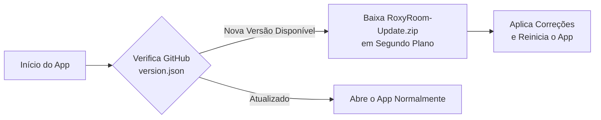

<div align="center">

  

  # 🌌 Roxy Room
  ### Streaming P2P de Tela e Áudio com Ultra-Baixa Latência & Aceleração Direct3D 11

  <p align="center">
    Compartilhe sua tela e áudio com amigos em tempo real, sem intermediários, sem atrasos e com um player moderno estilo YouTube.
  </p>

  <p align="center">
    <a href="https://github.com/mariocesarflore/Roxy-Room/releases/latest">
      
    </a>
    <a href="https://github.com/mariocesarflore/Roxy-Room/releases">
      
    </a>
    <a href="#-licença">
      
    </a>
  </p>

  <p align="center">
    
    
    
    
    
  </p>

  <br />

  <p align="center">
    <a href="https://github.com/mariocesarflore/Roxy-Room/releases">
      
    </a>
  </p>

</div>

---

## 📑 Sumário

- [Visão Geral](#-visão-geral)
- [Principais Recursos](#-principais-recursos)
- [Player Estilo YouTube](#-player-minimalista-estilo-youtube)
- [Tabela de Atalhos](#-atalhos-de-teclado)
- [Sistema de Auto-Update](#-sistema-de-atualização-automática)
- [Arquitetura & Tecnologias](#-arquitetura--tecnologias)
- [Como Baixar e Usar](#-como-baixar-e-usar)
- [Compilação & Desenvolvimento](#-compilação-e-desenvolvimento)
- [Licença](#-licença)

---

## 💡 Visão Geral

O **Roxy Room** é uma aplicação nativa para Windows desenvolvida para oferecer compartilhamento de tela e áudio entre amigos com **foco absoluto em performance, baixa latência e simplicidade**.

Ao contrário de serviços pesados que passam todo o tráfego de vídeo por servidores proprietários (gerando filas e compressões pesadas), o Roxy Room utiliza conexão direta **P2P (Peer-to-Peer) via WebRTC**, garantindo que o vídeo viaje diretamente entre você e quem está assistindo, aproveitando a aceleração de hardware nativa **Direct3D 11**.

---

## ✨ Principais Recursos

<table>
  <tr>
    <td width="50%">
      <h3>🚀 Ultra-Baixa Latência P2P</h3>
      <p>Transmissão direta entre máquinas com suporte inteligente a STUN e ICE, reduzindo o delay para milissegundos.</p>
    </td>
    <td width="50%">
      <h3>🎮 Aceleração por GPU Direct3D 11</h3>
      <p>Renderização de vídeo nativa acelerada por hardware, garantindo 60 FPS estáveis com 0% de sobrecarga na CPU.</p>
    </td>
  </tr>
  <tr>
    <td width="50%">
      <h3>🎛️ Player Estilo YouTube</h3>
      <p>Interface minimalista nos cantos, slider de volume deslizante com expansão suave, tag AO VIVO e auto-ocultação inteligente.</p>
    </td>
    <td width="50%">
      <h3>🔊 Captura Seletiva de Áudio</h3>
      <p>Transmita o som cristalino do jogo ou do sistema usando WASAPI loopback, com opção de isolar ou excluir processos.</p>
    </td>
  </tr>
  <tr>
    <td width="50%">
      <h3>🗗 Janela Separada / Popout</h3>
      <p>Destaque qualquer transmissão em uma janela flutuante independente para assistir em um segundo monitor.</p>
    </td>
    <td width="50%">
      <h3>🔄 Atualização Automática</h3>
      <p>Mecanismo de auto-update integrado: quando uma nova versão é publicada, o app atualiza sozinho em segundos.</p>
    </td>
  </tr>
</table>

---

## 🎬 Player Minimalista Estilo YouTube

O player do Roxy Room foi desenhado para maximizar a área útil do vídeo:

- **Controles nos Cantos:**
  - **Canto Inferior Esquerdo:** Botão Play/Pause, ícone de alto-falante com controle deslizante horizontal (*hover slide-out*) e indicador pulsante `🔴 AO VIVO`.
  - **Canto Inferior Direito:** Botão de Captura Instantânea (`📸 Print HD`), Janela Destacada (`🗗 Popout`) e Tela Cheia (`⛶ Fullscreen`).
- **Auto-Ocultação Inteligente:** Os controles e o cursor do mouse somem suavemente após 2.5 segundos de inatividade e reaparecem ao mover o mouse.
- **Gradiente Sutil:** O fundo dos botões possui um degradê suave e transparente, sem faixas escuras bloqueando o vídeo.

---

## ⌨️ Atalhos de Teclado

| Tecla / Atalho | Ação no Player |
| :--- | :--- |
| <kbd>Espaço</kbd> ou <kbd>K</kbd> | Alternar Play / Pause |
| <kbd>M</kbd> | Mutar / Desmutar Áudio |
| <kbd>F</kbd> | Alternar Tela Cheia |
| <kbd>↑</kbd> *(Seta Cima)* | Aumentar Volume (+5%) |
| <kbd>↓</kbd> *(Seta Baixo)* | Diminuir Volume (-5%) |
| <kbd>Esc</kbd> | Sair da Tela Cheia / Fechar Player |
| <kbd>Alt</kbd> + <kbd>G</kbd> | Iniciar / Parar Transmissão Instantaneamente |

---

## 🔄 Sistema de Atualização Automática

O Roxy Room possui um **Auto-Updater nativo** que elimina a necessidade de reinstalação manual:



1. Toda vez que o aplicativo abre (e a cada 45 minutos), ele consulta o repositório em busca de novas versões.
2. Se houver uma atualização, o usuário recebe um aviso elegante com o changelog.
3. Ao confirmar, o download ocorre em segundo plano, os arquivos são substituídos com segurança e o aplicativo reabre já na nova versão!

---

## 🏛️ Arquitetura & Tecnologias

- **Linguagem Principal:** C++17 nativo de alta performance (Win32 API)
- **Renderização e Vídeo:** Microsoft Direct3D 11 (D3D11) & DXGI Desktop Duplication
- **Captura de Áudio:** Windows Core Audio (WASAPI Loopback Capture)
- **Interface e Experiência:** WebView2 (Chromium Embedded) com design Dark Glassmorphism
- **Conectividade:** WebRTC P2P com fallback via PeerJS & STUN servers
- **Empacotamento & Deploy:** Utilitário Python automatizado + GitHub Actions CI/CD

---

## 📥 Como Baixar e Usar

### Instalação Rápida:
1. Vá até a seção de **[Releases](https://github.com/mariocesarflore/Roxy-Room/releases)**.
2. Baixe o instalador oficial **`Roxy Room Setup.exe`**.
3. Execute o instalador (ele cria os atalhos automaticamente na sua Área de Trabalho e Menu Iniciar).

### Como Transmitir e Assistir:
1. **Entrar na Sala:** Ao abrir, digite ou copie o código da sala (ex: `SALA-1234`).
2. **Compartilhar:** Clique em **"Iniciar Transmissão"** (ou pressione <kbd>Alt + G</kbd>) e escolha a tela ou aplicativo desejado com áudio.
3. **Assistir:** A transmissão do seu amigo aparecerá automaticamente com qualidade máxima e áudio sincronizado.

---

## 🛠️ Compilação e Desenvolvimento

Para quem deseja contribuir ou compilar o projeto do zero:

### Pré-requisitos
- **Windows 10 / 11 (64-bit)**
- **Visual Studio 2022** com suporte a desenvolvimento Desktop em C++
- **Python 3.8+**

### 1. Clonar o Repositório
```bash
git clone https://github.com/mariocesarflore/Roxy-Room.git
cd Roxy-Room
```

### 2. Compilar o Executável
Execute o script de compilação rápida:
```bash
build.bat
```
O executável compilado será gerado em `bin/RoxyRoom.exe`.

### 3. Gerar Nova Versão e Pacote de Atualização
Para gerar um novo instalador e o pacote `.zip` para o auto-updater:
```bash
python tools/package_release.py 1.0.1 "Correção de bugs e melhorias no player"
```

---

## 📄 Licença

Distribuído sob a **Licença MIT**. Consulte o arquivo [`LICENSE`](LICENSE) para mais detalhes.

<div align="center">
  <p>Feito com carinho e café por <strong><a href="https://github.com/mariocesarflore">Mário César Flore</a></strong> 🚀</p>
</div>
