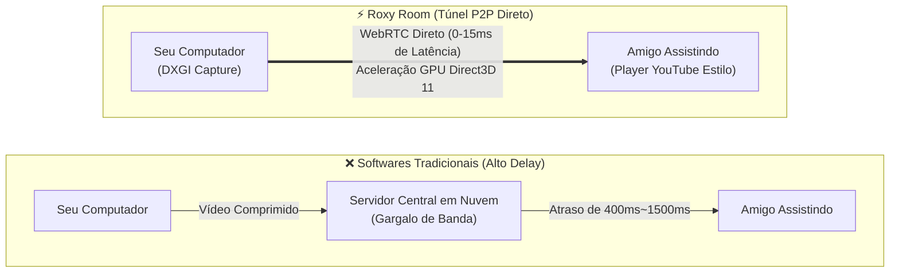
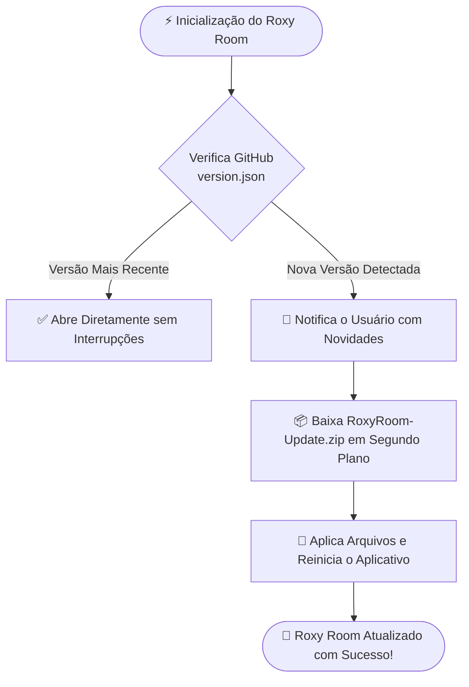

<div align="center">

  <br />

  <a href="https://github.com/mariocesarflore/Roxy-Room">
    
  </a>

  <h1 align="center" style="font-weight: 800; font-size: 2.4rem; letter-spacing: -0.5px; margin-top: 15px;">
    🌌 ROXY ROOM
  </h1>

  <p align="center">
    <a href="https://github.com/mariocesarflore/Roxy-Room">
      
    </a>
  </p>

  <p align="center">
    <strong>Compartilhamento de tela e áudio entre amigos com foco total em ultra-baixa latência, leveza e privacidade.</strong>
  </p>

  <!-- Badges Primários -->
  <p align="center">
    <a href="https://github.com/mariocesarflore/Roxy-Room/releases/latest">
      
    </a>
    <a href="https://github.com/mariocesarflore/Roxy-Room/releases">
      
    </a>
    <a href="#-licença--termos-de-uso">
      
    </a>
  </p>

  <!-- Badges Tecnologias -->
  <p align="center">
    
    
    
    
    
  </p>

  <br />

  <!-- Botão de Download Principal -->
  <p align="center">
    <a href="https://github.com/mariocesarflore/Roxy-Room/releases/latest/download/Roxy.Room.Setup.exe">
      
    </a>
  </p>

  <br />

</div>

---

## 📑 Navegação Rápida

<p align="center">
  <a href="#-por-que-o-roxy-room"><b>Por Que o Roxy Room?</b></a> •
  <a href="#-principais-recursos"><b>Recursos</b></a> •
  <a href="#-player-minimalista-estilo-youtube"><b>Player Estilo YouTube</b></a> •
  <a href="#-atalhos-de-teclado"><b>Atalhos</b></a> •
  <a href="#-sistema-de-atualização-automática"><b>Auto-Update</b></a> •
  <a href="#-como-usar"><b>Como Usar</b></a> •
  <a href="#-licença--termos-de-uso"><b>Licença</b></a>
</p>

---

## 💡 Por Que o Roxy Room?

Enquanto programas tradicionais enviam todo o tráfego de vídeo para servidores centrais de empresas terceiras (adicionando filas, compressões pesadas e atrasos visíveis), o **Roxy Room** estabelece um **túnel direto P2P** entre os computadores:



---

## ✨ Principais Recursos

<table>
  <tr>
    <td width="50%" valign="top">
      <h3>🚀 Ultra-Baixa Latência (P2P Puro)</h3>
      <p>Conexão direta ponta-a-ponta via WebRTC. O vídeo viaja em milissegundos pela rede sem intermediários ou perda de taxa de quadros.</p>
    </td>
    <td width="50%" valign="top">
      <h3>🎮 Aceleração por GPU Direct3D 11</h3>
      <p>Renderização com hardware nativo da placa de vídeo. Mantém 60 FPS lisos durante jogos pesados com 0% de uso de CPU.</p>
    </td>
  </tr>
  <tr>
    <td width="50%" valign="top">
      <h3>🎛️ Player Estilo YouTube</h3>
      <p>Controles discretos posicionados nos cantos, slider de volume deslizante com expansão suave, tag <code>AO VIVO</code> e auto-hide inteligente.</p>
    </td>
    <td width="50%" valign="top">
      <h3>🔊 Captura Seletiva de Áudio</h3>
      <p>Compartilhe o som de alta definição do jogo via Windows WASAPI Loopback, com suporte para isolar ou excluir sons indesejados.</p>
    </td>
  </tr>
  <tr>
    <td width="50%" valign="top">
      <h3>🗗 Janela Separada / Popout</h3>
      <p>Destaque qualquer transmissão da sala em uma janela flutuante independente para assistir em um segundo monitor com facilidade.</p>
    </td>
    <td width="50%" valign="top">
      <h3>🔄 Auto-Updater Integrado</h3>
      <p>Sem necessidade de reinstalação manual: novas versões lançadas são detectadas, baixadas e aplicadas automaticamente.</p>
    </td>
  </tr>
</table>

---

## 🎬 Player Minimalista Estilo YouTube

Inspirado na experiência fluida do YouTube, o player do Roxy Room foi desenhado para manter o foco total no vídeo, posicionando os controles de forma sutil e inteligente nos cantos:

<table>
  <tr>
    <td width="33%" align="center">
      <h3>🕹️ Controles de Mídia</h3>
      <p>Alternância instantânea de Play / Pause com feedback suave e sem atrasos.</p>
    </td>
    <td width="33%" align="center">
      <h3>🔊 Volume Deslizante</h3>
      <p>Controle horizontal retrátil que se expande suavemente ao passar o cursor (<em>hover slide-out</em>).</p>
    </td>
    <td width="33%" align="center">
      <h3>🔴 Chip Ao Vivo</h3>
      <p>Indicador discreto de transmissão em tempo real com efeito de pulso luminoso.</p>
    </td>
  </tr>
  <tr>
    <td width="33%" align="center">
      <h3>📸 Captura Instantânea</h3>
      <p>Tire prints em alta definição direto da transmissão com apenas um clique.</p>
    </td>
    <td width="33%" align="center">
      <h3>🗗 Janela Popout</h3>
      <p>Destaque a transmissão em uma janela separada nativa para outro monitor.</p>
    </td>
    <td width="33%" align="center">
      <h3>✨ Auto-Ocultação</h3>
      <p>Controles e cursor somem após 2.5s de inatividade e ressurgem ao mover o mouse.</p>
    </td>
  </tr>
</table>

---

## ⌨️ Atalhos de Teclado

Controle tudo sem precisar encostar o cursor na tela:

| Tecla / Atalho | Ação Executada |
| :---: | :--- |
| <kbd>Espaço</kbd> ou <kbd>K</kbd> | Alternar entre Pausar e Retomar o vídeo |
| <kbd>M</kbd> | Mutar / Desmutar o áudio da transmissão |
| <kbd>F</kbd> | Entrar ou Sair do modo **Tela Cheia** |
| <kbd>↑</kbd> *(Seta Cima)* | Aumentar o volume (+5%) |
| <kbd>↓</kbd> *(Seta Baixo)* | Diminuir o volume (-5%) |
| <kbd>Esc</kbd> | Fechar tela cheia / Fechar o player |
| <kbd>Alt</kbd> + <kbd>G</kbd> | **Iniciar / Encerrar Transmissão** de qualquer lugar no Windows |

---

## 🔄 Sistema de Atualização Automática

O Roxy Room possui um motor nativo de **Zero-Install Auto-Update**:



- A verificação ocorre de forma transparente ao iniciar o app e periodicamente a cada 45 minutos.
- O download ocorre em segundo plano sem congelar a tela.

---

## 👥 Como Usar

### 1. Instalação (Rápida em 1 Clique)
1. Baixe o instalador oficial **[`Roxy.Room.Setup.exe`](https://github.com/mariocesarflore/Roxy-Room/releases/latest/download/Roxy.Room.Setup.exe)**.
2. Execute o instalador para criar os atalhos na Área de Trabalho e no Menu Iniciar.

### 2. Entrar ou Criar uma Sala
1. Abra o **Roxy Room**.
2. Copie o seu código da sala (ex: `SALA-7421`) e envie para seu amigo.
3. Seu amigo digita o código e clica em **Conectar**.

### 3. Transmitir e Assistir
1. Pressione o atalho global **<kbd>Alt + G</kbd>** ou clique no botão **"Iniciar Transmissão"**.
2. Escolha sua tela cheia ou aplicativo específico com áudio ativado.
3. A transmissão é exibida automaticamente para quem estiver na sala com qualidade máxima e som cristalino.

---

## 🛠️ Compilação e Desenvolvimento Local

Para desenvolvedores que desejam compilar o projeto do zero:

```bash
# 1. Clone o repositório
git clone https://github.com/mariocesarflore/Roxy-Room.git
cd Roxy-Room

# 2. Compile o executável nativo em C++ (bin/RoxyRoom.exe)
tools\build.bat

# 3. Empacotar uma nova release com instalador
python tools/package_release.py 1.0.1 "Correções e melhorias"
```

---

## 📄 Licença & Termos de Uso

Este projeto está registrado e protegido sob os termos da **[Licença MIT](LICENSE)**.

<div align="center">

| Permissões Oficiais | Condições | Limitações Legais |
| :---: | :---: | :---: |
| ✅ **Uso Comercial** | ℹ️ Preservação dos avisos de Copyright e Licença | ❌ Nenhuma Garantia de Software |
| ✅ **Modificação do Código** | | ❌ Isenção Total de Responsabilidade |
| ✅ **Distribuição Gratuita** | | |
| ✅ **Uso Pessoal e Privado** | | |

<br />

<p>
  Desenvolvido com carinho e dedicação por <strong><a href="https://github.com/mariocesarflore">Mário César Flore</a></strong> 🚀
</p>

<p>
  <a href="https://github.com/mariocesarflore/Roxy-Room">
    
  </a>
  &nbsp;
  <a href="https://github.com/mariocesarflore/Roxy-Room/fork">
    
  </a>
</p>

</div>
